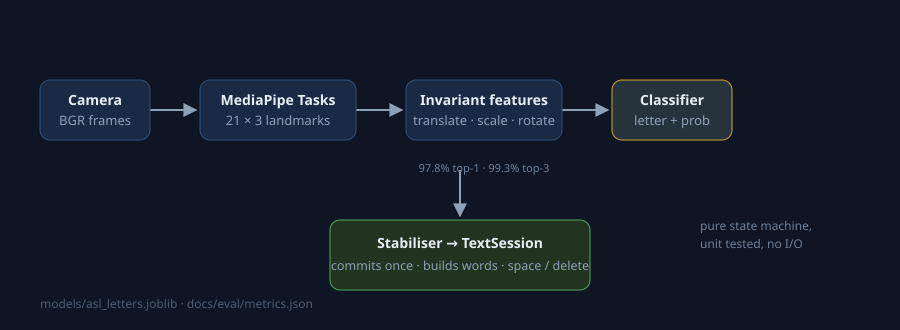

# Sign-Language Translator (ASL fingerspelling)

Hold a letter in front of the camera, and the app fingerspells it into a word.
MediaPipe hand landmarks + a classifier trained on a landmark corpus.



```
webcam → hand landmarks (21×3) → invariant features (63) → classifier → letter
                                                              ↓
        stablilsed into a single commit — not per-frame noise
                                                              ↓
        words buffer · SPACE ends a word · DELETE eats a letter
```

- **97.8% top-1 / 99.3% top-3** on a held-out 15% split of a 63,580-sample
  landmark corpus. 28 of the 29 classes are scored: `NOTHING` has a single
  sample, so the `MIN_CLASS_SAMPLES = 5` rule drops it — and `metrics.json`
  records that under `dropped_classes`, so the class count can never drift from
  what was actually measured. Full per-class breakdown in
  `docs/eval/metrics.json` and `docs/eval/confusion.png`.
- Classification is deliberately *cheap*: scikit-learn trees, a 6 MB model file —
  no GPU, no training-from-scratch pipeline required to demo.
- The letter-building logic is a pure, tested state machine: no frame-level
  flicker, no repeats, and a `--selftest` that scores the bundled model without a
  camera.

## Why this is not just a demo

Two engineering problems get solved instead of glossed over:

1. **Landmarks are camera-relative.** A hand not centered in the frame or 30 cm
   away looks completely differently normalised. `app/features.py` removes the
   wrist location, the hand scale and the camera roll *before* the classifier
   sees anything — the same function runs in training, so the two cannot drift.
2. **A video stream is not a sequence of independent images.** A confident letter
   that flickers for 20 frames would otherwise commit 20 letters. The text layer
   is its own state machine (`app/translator.py`) that needs repeated agreement
   over a window and refuses to re-commit while a gesture is held, with unit
   tests for all of exactly those cases.

## Quickstart

```bash
python -m venv .venv && .venv/bin/activate        # Windows: .venv\Scripts\activate
pip install -r requirements.txt
python scripts/download_data.py                  # ~14 MB landmark corpus
python -m app.train                              # ~2 min: trains + evaluates + writes models/
python -m app.realtime                           # live camera (cv2 window)
python -m app.realtime --selftest                # no camera: score the bundled model
```

In the window: `space` ends a word, `x` deletes, `c` clears, `q` quit.

## Architecture

```
app/
  features.py   landmark geometry → 63 invariant features (pure, tested)
  translator.py confidence-stabilised letter commits → text (pure, tested)
  model.py      joblib model + class-id → letter contract
  landmarks.py  MediaPipe Tasks hand landmarker (VIDEO mode) + skeleton drawing
  realtime.py   camera loop, HUD, keyboard controls, --selftest
  train.py      trains 3 different classifiers, keeps the best, writes metrics
tests/
scripts/        download_data.py — fetches the landmark corpus
models/         bundled trained model + labels.json
docs/eval/      metrics.json, confusion.png
```

## What the eval measures, honestly

`metrics.json` reports results on a stratified 15% test split of the corpus.

One class is *not* in that report: `NOTHING` appears exactly once in the corpus,
and a single sample cannot be stratified, so it is dropped by the
`MIN_CLASS_SAMPLES = 5` rule. The drop is written to `metrics.json` rather than
silently changing the denominator — 29 classes in the label contract, 28 scored.

| model | accuracy | top-3 |
|---|---:|---:|
| Logistic regression | 96.3% | 98.8% |
| Random forest | 97.6% | 99.3% |
| Hist gradient boosting | **97.8%** | 99.3% |

Hardest classes are the classic confusions: **M/N** (mirror shapes) and **U/I/J**
(finger positions overlap). Nothing scores below 88% recall.

`--selftest` scores a random slice of the *whole* corpus, which overlaps with the
training split — treat it as a plumbing check ("model, features and labels line
up"), not an accuracy statement. The honest number is `metrics.json`.

## Dataset provenance & licence

The classifier is trained on a **derivation**, not a re-implementation:

- Source corpus: [Kaggle ASL Alphabet](https://www.kaggle.com/datasets/grassknoted/asl-alphabet)
  (Samir Bhattarai, CC BY-SA 4.0).
- Pre-extracted landmark form: `data/asl_landmarks.npz` from
  [AbhisumatK/Real-Time-ASL-Alphabet-Recognition-System](https://github.com/AbhisumatK/Real-Time-ASL-Alphabet-Recognition-System),
  re-distributed under that licence's terms.

Because the derivation is a public artifact I re-use rather than re-extract, this
repository directly credits both. `scripts/download_data.py` fetches it at build
time rather than bundling a redistributable copy here; to rebuild from scratch —

```bash
pip install kagglehub && python -c "import kagglehub; kagglehub.dataset_download('grassknoted/asl-alphabet')"
```

— and run the landmark extraction yourself.

## Known limits

- **ASL J and Z are motion letters.** A still-image corpus fundamentally has
  nothing to teach about the *motion*, so those letters are recognised from their
  frame-shape alone and will feel wrong in the hand. Fixing that properly means a
  video dataset, which is a much different project.
- **Single left hand only**, and the classifier was trained on right-hand
  samples — left-handed use needs a mirror note (see roadmap).
- **Distribution shift.** The corpus is one hand per class under studio-ish
  lighting. Recognition on darker skin tones / unusual backgrounds / a tilted
  laptop camera degrades without a personal calibration pass.
- **The text state machine sees one hand at a time.** Sign-language is really a
  two-hand language (e.g. "B", several fingerspelled letters need both). That is
  the biggest accuracy-ratio giveaway between demo and product.

## Roadmap

- [ ] Two-hand mode in the tracker and classifier
- [ ] Word boundaries driven by pauses (no keyboard needed)
- [ ] Personal-calibration mode: collect 20 samples per letter and hot-swap the model
- [ ] A video-based letters corpus for the motion letters
- [ ] README GIF of the actual overlay

## License

MIT — see [LICENSE](LICENSE). The dataset licence is covered above.
